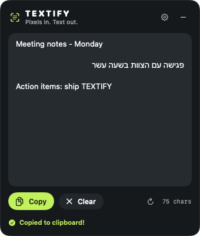

# TEXTIFY

A tiny macOS menu-bar utility: give it a screenshot and the text lands on your clipboard, ready to paste.

Screenshot → ⌘V into TEXTIFY → on-device OCR → clipboard updated → paste anywhere.

<p align="center">
  
  &nbsp;
  
</p>

## Build & run

Requirements: macOS 14+, Swift toolchain (Command Line Tools is enough, no Xcode needed).

```bash
scripts/build-app.sh            # builds build/TEXTIFY.app
open build/TEXTIFY.app

scripts/build-app.sh --install  # builds and copies to /Applications
```

TEXTIFY lives in the menu bar (viewfinder icon) and has no Dock icon. Quit it from the menu-bar menu, or with ⌘Q while the panel is focused.

For development: `swift build` (see the SDK note below), then `.build/debug/Textify`.

## Using it

| Input | How |
|---|---|
| Paste | Take a screenshot to the clipboard (⌃⇧⌘4, or copy an image in a browser or Finder), **click the TEXTIFY panel**, press **⌘V**. You can also click the ⌘V hint |
| Drag & drop | Drop an image file or a screenshot thumbnail onto the panel |
| Pick a file | Click the drop zone |
| Global shortcut | **⌘⇧V** from any app shows TEXTIFY and processes the clipboard image (change or disable it in Settings) |

> **Why click first?** The panel floats above other apps, but ⌘V only reaches TEXTIFY while the panel has keyboard focus. Otherwise it goes to the app you were using. The hint reads **"Click here, then press ⌘V"** when the panel isn't focused and turns green ("Press ⌘V") when it is. The click that focuses the panel doesn't open the file picker. To skip the click entirely, use the global shortcut **⌘⇧V**.
>
> Tip: **⌘⇧4** saves screenshots to the Desktop. Add **⌃** (⌃⇧⌘4) to copy them to the clipboard instead.

Text is copied automatically. **Tables paste as cells:** when the screenshot contains a table (macOS 26+), the clipboard also carries it as an HTML table and as tab-separated values. Pasting into Excel, Numbers, Google Sheets, Mail or Docs creates a real table, while plain-text apps get the regular text. This upgrade only happens if the clipboard still holds TEXTIFY's text, so anything you've copied since is never overwritten.

Text is copied automatically. The panel also has **Copy**, **Clear** and **Re-scan**. **Esc** clears the result, or hides the panel if it's already empty. **⌘W** hides it and **⌘,** opens Settings.

### Save to file (optional)

Turn on **Settings → Save to file** to also write every extraction to disk. It's off by default.

- **New file each time** creates `TEXTIFY 2026-11-20 at 23.41.05 - Acme Invoice Due December.txt` (a name collision gets ` 2`, ` 3`, …).
- **Append to one file** adds each extraction to `TEXTIFY Log.txt` under a header with the timestamp and label.
- **Labels** are short, memorable titles generated on your Mac. On macOS 26+ with Apple Intelligence, Apple's on-device language model writes them. Otherwise, or if the model takes longer than 4 s, a local keyword heuristic is used. Hebrew text gets an English title from the model, or its first words from the heuristic. The clipboard copy happens immediately; only the file waits for the label (usually under 1 s).
- The default folder is `~/Documents/TEXTIFY`. Use **Choose…** to pick another one. The first save into Documents triggers a one-time macOS permission prompt.
- The status line reads **Copied & saved!**, and the result view gets a Show-in-Finder button. If saving fails, the text is still copied and a warning explains why.
- Pasting the same image again doesn't create a duplicate file. Re-scan does save again.

### Tables → Excel

When **Save tables as Excel spreadsheets** is on (the default once auto-save is enabled) and the screenshot contains a clearly structured table, TEXTIFY saves an **.xlsx** that reproduces it:

- The same rows and columns, with or without grid lines in the image, and **merged cells** preserved.
- Numbers are stored as **real numbers** that display exactly as in the image (`1,299.00`, `8.5%`, `85`), so you can sum and sort them. Values that only look numeric, like `0512`, stay text.
- A text-only first row becomes a **bold, frozen header**.
- **Hebrew tables** get a right-to-left sheet with the same visual column order as the image. Cell text comes from Tesseract.
- Each table gets its own sheet. A **Full Text** sheet keeps everything else in the screenshot.
- In *New file each time* mode, the .xlsx replaces the .txt. In *Append* mode, the text is still appended to the log, with a note pointing to the .xlsx saved next to it.

Detection uses Apple's on-device document analysis (`RecognizeDocumentsRequest`, **macOS 26+**). Images without a real table, like paragraphs, invoices laid out as lines, or recipes, are saved as text as before. The .xlsx is written by TEXTIFY itself, with no Office or third-party libraries required.

Supported formats: PNG, JPEG, HEIC/HEIF, TIFF, BMP and GIF.

## Hebrew

Apple's on-device OCR engines (Vision and Live Text) don't support Hebrew. TEXTIFY reads Hebrew with **Tesseract**, an open-source engine that runs locally:

```bash
brew install tesseract
curl -L -o "$(brew --prefix)/share/tessdata/heb.traineddata" \
  https://github.com/tesseract-ocr/tessdata_best/raw/main/heb.traineddata
# or install every language: brew install tesseract tesseract-lang
```

When Tesseract is installed, it runs in parallel with Vision and supplies the lines that contain Hebrew. Vision handles everything else. Hebrew paragraphs display right-to-left. You can toggle Hebrew support in Settings. Without Tesseract, English and the other Vision languages still work.

## Privacy

- All OCR runs on your Mac. The app has no networking code.
- Images are held in memory only and never written to disk. Tesseract receives the image through a stdin pipe.
- Extracted text is never logged. It's written to disk only if you turn on *Save to file*.
- The clipboard is overwritten only after OCR returns non-empty text. If no text is found, the clipboard is left unchanged.
- An identical image is not re-processed unless you press Re-scan. TEXTIFY just puts the existing text back on the clipboard.

## Permissions

None. The global shortcut uses Carbon `RegisterEventHotKey`, which needs no Accessibility permission. TEXTIFY never captures the screen itself, so it doesn't need Screen Recording permission either.

## Notes and limitations

- **⌘⇧V** shadows "Paste and Match Style" in other apps while it's enabled. If you use that a lot, switch to ⌃⌥⌘V or ⌃⇧T in Settings.
- **SDK note:** the macOS 27 SDK in Command Line Tools ships SwiftUI macros (`@State`) without their compiler plugin, so `build-app.sh` builds against the macOS 26 SDK when Xcode isn't installed. For a manual build, use `SDKROOT=/Library/Developer/CommandLineTools/SDKs/MacOSX26.sdk swift build`. With Xcode installed, plain `swift build` works.
- The app is ad-hoc signed. That's fine on the Mac that built it. Copying it to another Mac would require right-click → Open, or a Developer ID signature and notarization.
- "Launch at login" is tied to the app's location. After `scripts/build-app.sh --install`, enable it from the installed copy, in Settings or with `--login-item on`.
- **"No text found" on an image that clearly has text:** macOS caches compiled OCR models per app, and that cache can get corrupted. TEXTIFY automatically retries with Vision's fast model, so you'll get the text, flagged "some text may be unclear". To fix the cache itself, quit TEXTIFY and delete `~/Library/Caches/com.textify.app`; macOS rebuilds it on the next use.
- Tesseract's very first run can take some time while it loads its model. After that, it adds about 0.1 s per image.

## Testing

```bash
scripts/run-tests.sh        # end-to-end suite: OCR, Hebrew, tables, .xlsx, clipboard (never saves files)
```

It skips the Hebrew checks without Tesseract and the table checks before macOS 26. CI runs the same script.

Individual helpers:

```bash
swift scripts/make-test-images.swift build/test-images   # English / Hebrew / mixed / multi-paragraph / blank
build/TEXTIFY.app/Contents/MacOS/Textify --ocr build/test-images/hebrew.png
build/TEXTIFY.app/Contents/MacOS/Textify --ocr-clipboard --no-save  # same pipeline as ⌘V, headless
build/TEXTIFY.app/Contents/MacOS/Textify --ocr-clipboard --save-to build/out [--append]  # also test auto-save
build/TEXTIFY.app/Contents/MacOS/Textify --label build/test-images/invoice.png             # show the file label
build/TEXTIFY.app/Contents/MacOS/Textify --table build/test-images/table-grid.png --xlsx out.xlsx  # detect + export a table
/Applications/TEXTIFY.app/Contents/MacOS/Textify --login-item on|off|status                 # manage Launch at login
TEXTIFY_SNAPSHOT_DIR=/tmp/snaps TEXTIFY_SNAPSHOT_IMAGE=build/test-images/mixed.png \
  build/TEXTIFY.app/Contents/MacOS/Textify               # renders each UI state to PNGs
```

## Layout

```
Sources/Textify/
  TextifyApp.swift          entry point, app delegate, menu-bar item
  FloatingPanelManager.swift floating NSPanel + ⌘V/Esc handling
  HotKeyManager.swift       global shortcut (Carbon)
  OCRService.swift          Vision OCR + reading-order/paragraph layout
  HebrewOCRService.swift    optional local Tesseract pass for Hebrew
  ClipboardManager.swift    pasteboard image read / text write
  TextFileSaver.swift       opt-in save of extracted text (new file / append)
  FileLabeler.swift         on-device label for saved files (Apple model → heuristic)
  TableExtractor.swift      table detection (Vision documents, macOS 26+; Hebrew cells via Tesseract)
  XLSXWriter.swift          dependency-free .xlsx writer (sheets, merges, number formats, RTL)
  TableClipboardFormat.swift tables as HTML + tab-separated values for the clipboard
  ImageLoader.swift         file/data → CGImage, format checks
  TextifyViewModel.swift    state machine (idle → processing → copied / no text / error)
  Views/                    ContentView, ImageDropZone, ExtractedTextView, SettingsView
```

## Contributing

Issues and pull requests are welcome. See [CONTRIBUTING.md](CONTRIBUTING.md).

## License

[MIT](LICENSE)
