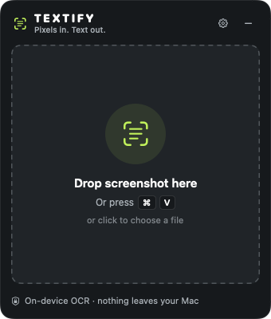

# TEXTIFY

**Pixels in. Text out.** A tiny macOS menu-bar utility: give it a screenshot and the text lands on your clipboard, ready to paste.

Screenshot → ⌘V into TEXTIFY → on-device OCR → clipboard updated → paste anywhere.

<p align="center">
  
  &nbsp;
  
</p>

## Build & run

Requirements: macOS 14+, Swift toolchain (Command Line Tools is enough, no Xcode needed).

```bash
scripts/build-app.sh            # builds build/TEXTIFY.app
open build/TEXTIFY.app

scripts/build-app.sh --install  # builds and copies to /Applications
```

TEXTIFY lives in the menu bar (viewfinder icon) and has no Dock icon. Quit it from the menu-bar menu, or with ⌘Q while the panel is focused.

For development: `swift build` (see the SDK note below), then `.build/debug/Textify`.

## Using it

| Input | How |
|---|---|
| Paste | Take a screenshot to the clipboard (⌃⇧⌘4, or copy an image in a browser or Finder), focus TEXTIFY, press **⌘V** |
| Drag & drop | Drop an image file or a screenshot thumbnail onto the panel |
| Pick a file | Click the drop zone |
| Global shortcut | **⌘⇧V** from any app shows TEXTIFY and processes the clipboard image (change or disable it in Settings) |

Text is copied automatically. The panel also has **Copy**, **Clear** and **Re-scan**. **Esc** clears the result, or hides the panel if it's already empty. **⌘W** hides it and **⌘,** opens Settings.

### Save to file (optional)

Turn on **Settings → Save to file** to also write every extraction to disk. It's off by default.

- **New file each time** creates `TEXTIFY 2026-11-20 at 23.41.05.txt` (a name collision gets ` 2`, ` 3`, …).
- **Append to one file** adds each extraction to `TEXTIFY Log.txt` under a timestamp header.
- The default folder is `~/Documents/TEXTIFY`. Use **Choose…** to pick another one. The first save into Documents triggers a one-time macOS permission prompt.
- The status line reads **Copied & saved!**, and the result view gets a Show-in-Finder button. If saving fails, the text is still copied and a warning explains why.
- Pasting the same image again doesn't create a duplicate file. Re-scan does save again.

Supported formats: PNG, JPEG, HEIC/HEIF, TIFF, BMP and GIF.

## Hebrew

Apple's on-device OCR engines (Vision and Live Text) don't support Hebrew. TEXTIFY reads Hebrew with **Tesseract**, an open-source engine that runs locally:

```bash
brew install tesseract
curl -L -o "$(brew --prefix)/share/tessdata/heb.traineddata" \
  https://github.com/tesseract-ocr/tessdata_best/raw/main/heb.traineddata
# or install every language: brew install tesseract tesseract-lang
```

When Tesseract is installed, it runs in parallel with Vision and supplies the lines that contain Hebrew. Vision handles everything else. Hebrew paragraphs display right-to-left. You can toggle Hebrew support in Settings. Without Tesseract, English and the other Vision languages still work.

## Privacy

- All OCR runs on your Mac. The app has no networking code.
- Images are held in memory only and never written to disk. Tesseract receives the image through a stdin pipe.
- Extracted text is never logged. It's written to disk only if you turn on *Save to file*.
- The clipboard is overwritten only after OCR returns non-empty text. If no text is found, the clipboard is left unchanged.
- An identical image is not re-processed unless you press Re-scan. TEXTIFY just puts the existing text back on the clipboard.

## Permissions

None. The global shortcut uses Carbon `RegisterEventHotKey`, which needs no Accessibility permission. TEXTIFY never captures the screen itself, so it doesn't need Screen Recording permission either.

## Notes and limitations

- **⌘⇧V** shadows "Paste and Match Style" in other apps while it's enabled. If you use that a lot, switch to ⌃⌥⌘V or ⌃⇧T in Settings.
- **SDK note:** the macOS 27 SDK in Command Line Tools ships SwiftUI macros (`@State`) without their compiler plugin, so `build-app.sh` builds against the macOS 26 SDK when Xcode isn't installed. For a manual build, use `SDKROOT=/Library/Developer/CommandLineTools/SDKs/MacOSX26.sdk swift build`. With Xcode installed, plain `swift build` works.
- The app is ad-hoc signed. That's fine on the Mac that built it. Copying it to another Mac would require right-click → Open, or a Developer ID signature and notarization.
- "Launch at login" works best once the app is in /Applications.
- Tesseract's very first run can take some time while it loads its model. After that, it adds about 0.1 s per image.

## Testing helpers

```bash
swift scripts/make-test-images.swift build/test-images   # English / Hebrew / mixed / multi-paragraph / blank
build/TEXTIFY.app/Contents/MacOS/Textify --ocr build/test-images/hebrew.png
build/TEXTIFY.app/Contents/MacOS/Textify --ocr-clipboard  # same pipeline as ⌘V, headless
build/TEXTIFY.app/Contents/MacOS/Textify --ocr-clipboard --save-to build/out [--append]  # also test auto-save
TEXTIFY_SNAPSHOT_DIR=/tmp/snaps TEXTIFY_SNAPSHOT_IMAGE=build/test-images/mixed.png \
  build/TEXTIFY.app/Contents/MacOS/Textify               # renders each UI state to PNGs
```

## Layout

```
Sources/Textify/
  TextifyApp.swift          entry point, app delegate, menu-bar item
  FloatingPanelManager.swift floating NSPanel + ⌘V/Esc handling
  HotKeyManager.swift       global shortcut (Carbon)
  OCRService.swift          Vision OCR + reading-order/paragraph layout
  HebrewOCRService.swift    optional local Tesseract pass for Hebrew
  ClipboardManager.swift    pasteboard image read / text write
  TextFileSaver.swift       opt-in save of extracted text (new file / append)
  ImageLoader.swift         file/data → CGImage, format checks
  TextifyViewModel.swift    state machine (idle → processing → copied / no text / error)
  Views/                    ContentView, ImageDropZone, ExtractedTextView, SettingsView
```

## Contributing

Issues and pull requests are welcome. See [CONTRIBUTING.md](CONTRIBUTING.md).

## License

[MIT](LICENSE)
